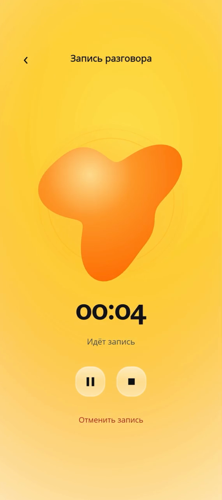
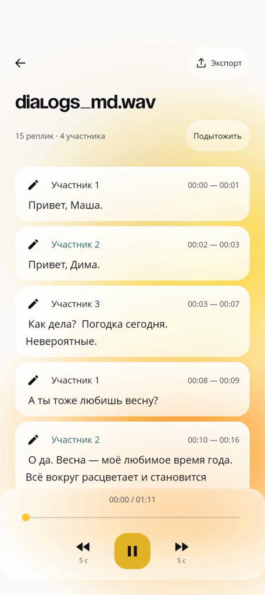
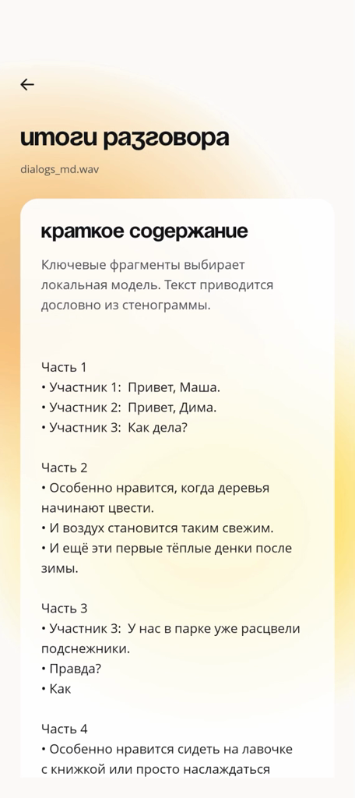

# Слово в слово · WordByWord

An Android app for offline transcription of Russian conversations with speaker diarization and JSON export.

## APK

[Download the APK from Google Drive](https://drive.google.com/drive/folders/1ZYgRJRdBaZq9iS3Q1PHWbhk9aVXv3mPC?usp=sharing).

## Demo

[Watch the full demo on Google Drive](https://drive.google.com/file/d/12FYlB7ZGbI-Oy_wZ1cP2QqgHO_Sz4Hw2/view).

| Recording | Transcript and playback | Summary |
| :---: | :---: | :---: |
|  |  |  |

## Installation and usage

Requirements: Android 8.0 or later, ARM64 or x86-64 processor.
Models are bundled in the APK; processing works without internet access.

1. Download the APK to your phone and open it.
2. Allow installation from the selected source and install the app.
3. Tap “Загрузить аудио” (Import audio) on the home screen and select a recording.
4. Start processing and wait for the transcript.
5. Tap an utterance to jump to the corresponding audio position.
6. Tap “Экспорт” (Export) and save the JSON file through the system picker.

To record with the microphone, tap “Записать разговор” (Record a conversation) and grant audio recording permission.
Recordings and completed transcripts are available in the library.
Speaker names can be changed in the transcript.
The “Подытожить” (Summarize) button opens summary generation for a completed transcript.
Generation runs on the device; the result is saved with the recording.
The model selects key passages, displayed verbatim from the transcript.
The export contains a `transcript` array with `speaker_id`, `start_ms`, `end_ms`, and `text` fields.

## Architecture and models

The app is written in Java with an XML interface.
Speech recognition and diarization run on the device CPU through sherpa-onnx 2.0.1.
Audio and text are not sent to external services.

Processing pipeline:

1. Import and save a private copy of the audio in application storage.
2. Decode with Android MediaExtractor/MediaCodec and convert to 16 kHz mono PCM.
3. Run speech recognition and diarization in parallel.
4. Assign text fragments to speaker intervals by temporal overlap.
5. Save, display, and export the transcript as JSON.

| Task | Model |
| --- | --- |
| Speech detection before ASR | Silero VAD |
| Russian speech recognition and punctuation | GigaAM v3 RNNT int8 |
| Speaker segmentation | pyannote/segmentation-3.0 int8 |
| Speaker embeddings for clustering | 3D-Speaker ERes2Net VoxCeleb |
| Summarization | Qwen3-0.6B INT4, LiteRT-LM 0.17.1 |

Processing and file operations run off the UI thread.
Audio is stored in files; transcripts and user changes are stored in JSON.

Details: [architecture](docs/ARCHITECTURE.md), [ASR and VAD](docs/asr-models.md), [diarization](docs/diarization-models.md), [export format](docs/PROTOCOL.md).

## Limitations

- Poor audio quality, noise, interference, and overlapping voices reduce ASR and diarization accuracy.
- Processing interrupted by process termination does not resume automatically.
- The APK uses a debug signing key.
Installing it over a version signed with another key may require removing the app and its local data.

[Detailed limitations](docs/LIMITATIONS.md).

## Test results

### Speech recognition — WER

**GigaAM v3 int8: 3.40% WER on 30 FLEURS validation recordings, excluding punctuation.**
The model recognizes Russian speech and adds punctuation without a separate postprocessor.

| Dataset | Size | WER |
| --- | ---: | ---: |
| FLEURS validation | 30 recordings | 3.40% |
| MINDS-14 | 120 recordings | 15.59% |
| Astrology | 189.778 s | 9.23% |
| Movie | 183.125 s | 14.54% |

WER (Word Error Rate) counts substitutions, deletions, and insertions; lower is better.
Punctuation is excluded in this table; this is a normalization rule, not a separate metric.

### Speaker diarization — DER

**Pyannote + ERes2Net VoxCeleb: 16.01–22.62% DER on the two conversation recordings below.**
The evaluated prefixes use the same sources and durations as the WER table.

| Dataset | Size | DER |
| --- | ---: | ---: |
| Astrology | 189.778 s | 16.01% |
| Movie | 183.125 s | 22.62% |

DER (Diarization Error Rate) counts missed speech, false speech, and speaker confusion; lower is better.
Evaluation uses zero boundary collar, includes overlapping speech, and optimally maps speaker IDs.

### Processing speed — RTF

**In the published run, full processing of the two conversation recordings was faster than real time: RTF 0.53–0.56.**
RTF (Real-Time Factor) is processing time divided by audio duration; values below 1 indicate faster-than-real-time processing.
Timing includes import, ASR, diarization, saving, and export.

| Recording | Audio duration | Processing time | RTF |
| --- | ---: | ---: | ---: |
| Astrology | 189.78 s | 100.63 s | 0.530 |
| Movie | 183.13 s | 103.18 s | 0.563 |
